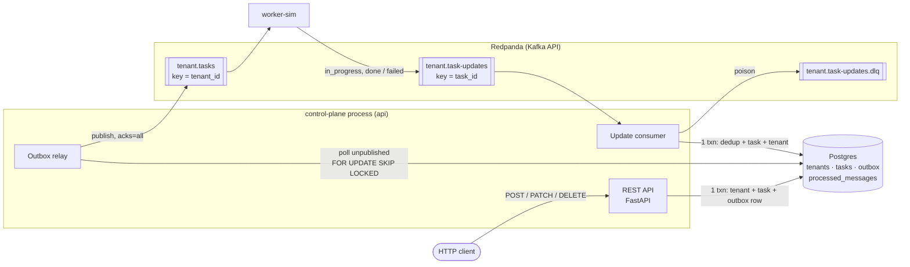

# Tenant Provisioning Control Plane

A control plane for asynchronously provisioned tenants. It has three parts:

- **REST API**: tenants (CRUD) and tasks (read-only), stored in Postgres.
- **Transactional outbox → Kafka**: every state change emits exactly one event, and only after the DB commit.
- **Update consumer**: applies worker progress. It is idempotent and tolerates out-of-order delivery.

A **worker simulator** consumes the tasks and reports `in_progress` → `done | failed`.

Stack: Python 3.12, FastAPI, asyncpg, Postgres 16, Redpanda (Kafka API), aiokafka, Docker Compose.

---

## Getting started

### 1. Prerequisites

| Tool | Why | Check |
|---|---|---|
| Docker Engine / Docker Desktop with **Compose v2** | Runs everything (Postgres, Redpanda, API, worker, tests) | `docker compose version` |
| `curl` | Trying the API | `curl --version` |
| `jq` *(optional)* | Pretty-prints JSON and captures ids in the examples below | `jq --version` |

- Nothing else is needed: no local Python, Postgres or Kafka.
- Leave Docker about 2 GB of free memory.
- Every command is plain `docker compose`; there is no other command runner.
- `docker compose` commands work in any shell, PowerShell included. The `curl`/`jq` examples and `scripts/publish-update.sh` are POSIX shell, so on Windows run them from **Git Bash** or **WSL**. Line endings are handled by `.gitattributes`.

### 2. Ports

| Host port | Service | Notes |
|---|---|---|
| **8000** | Control-plane HTTP API | Swagger UI at `/docs`, liveness `/healthz`, readiness `/readyz` |
| **19092** | Redpanda (Kafka API) | Only for host-side Kafka tools. Containers talk to each other on `redpanda:9092`. |
| *(none)* | Postgres | Not published, reachable only inside the compose network (see [inspect the database](#inspect-the-database)) |

If a port is already taken, the boot command fails with `port is already allocated`. Either free the port, or pick another one:

```bash
# bash / Git Bash / WSL
API_PORT=8080 KAFKA_PORT=29092 docker compose up --build -d --wait api worker
```

```powershell
# PowerShell
$env:API_PORT=8080; $env:KAFKA_PORT=29092; docker compose up --build -d --wait api worker
```

Then use `http://localhost:8080` in the examples.

To see what is holding a port: `lsof -i :8000` (macOS/Linux) or `netstat -ano | findstr :8000` (Windows).

### 3. Boot

```bash
git clone <your-repo> && cd <your-repo>
docker compose up --build -d --wait api worker
```

This builds one image and starts the stack in this order:
1. `postgres`
2. `redpanda`
3. the one-shot `topics` container (creates the 3 topics)
4. `api` (applies DB migrations on start-up)
5. `worker`

`--wait` makes it return only once the API is healthy, at <http://localhost:8000>. The first run pulls images and installs dependencies, which takes a few minutes; later runs take seconds.

Check that it is up:

```bash
curl -s localhost:8000/readyz        # {"status":"ready"}
docker compose ps                    # api: healthy, worker: running, topics: exited (0)
```

### 4. Try the API

Copy-paste these in order. The worker runs with its default delays (0.5–2 s per step), so a task finishes in a few seconds.

```bash
BASE=http://localhost:8000          # change if you set API_PORT
```

**a) Create a tenant** → `201 Created`. The tenant is `provisioning`, and a `deploy` task is `accepted`.

```bash
RESP=$(curl -s -X POST "$BASE/v1/tenants" \
  -H 'content-type: application/json' \
  -d '{"slug":"acme-prod","name":"Acme Corp"}')
echo "$RESP" | jq
TID=$(echo "$RESP" | jq -r .tenant.id)
```

```json
{
  "tenant": {
    "id": "0d80a750-2d69-45ce-ae5e-8e8518f29348",
    "slug": "acme-prod",
    "name": "Acme Corp",
    "status": "provisioning",
    "version": 1,
    "created_at": "2026-11-22T14:13:47.597Z",
    "updated_at": "2026-11-22T14:13:47.597Z"
  },
  "task": {
    "id": "59fc297f-9c53-43af-b3e5-ccfc9d5ff666",
    "type": "deploy",
    "tenant_id": "0d80a750-2d69-45ce-ae5e-8e8518f29348",
    "status": "accepted",
    "error": null,
    "created_at": "2026-11-22T14:13:47.597Z",
    "updated_at": "2026-11-22T14:13:47.597Z"
  }
}
```

> No `jq`? Drop the `| jq` and copy the `tenant.id` from the output into `TID=...` by hand.

**b) Watch the worker finish it.** After a few seconds the tenant is `active` at version 2, and the task is `done`.

```bash
curl -s "$BASE/v1/tenants/$TID" | jq          # "status": "active", "version": 2
curl -s "$BASE/v1/tenants/$TID/tasks" | jq    # deploy task: accepted -> in_progress -> done
```

```json
{
  "items": [
    {
      "id": "59fc297f-9c53-43af-b3e5-ccfc9d5ff666",
      "type": "deploy",
      "tenant_id": "0d80a750-2d69-45ce-ae5e-8e8518f29348",
      "status": "done",
      "error": null,
      "created_at": "2026-11-22T14:13:47.597Z",
      "updated_at": "2026-11-22T14:13:49.842Z"
    }
  ],
  "next_cursor": null
}
```

**c) Update it (optimistic locking).** `version` must equal the current version. You get `202 Accepted`, and the tenant goes `updating` at version 3, then back to `active` at version 4.

```bash
curl -s -X PATCH "$BASE/v1/tenants/$TID" \
  -H 'content-type: application/json' \
  -d '{"version":2,"name":"Acme Corporation"}' | jq
```

Sending the same request again (stale `version: 2`) → `409`:

```json
{
  "error": {
    "code": "tenant_version_conflict",
    "message": "tenant was modified concurrently (expected version 2, current is 3)",
    "details": { "expected_version": 2, "current_version": 3 }
  }
}
```

**d) List, filter, paginate**

```bash
curl -s "$BASE/v1/tenants?status=active&limit=10" | jq
curl -s "$BASE/v1/tasks?tenant_id=$TID&type=update" | jq
curl -s "$BASE/v1/tenants?limit=1" | jq .next_cursor     # pass it back as ?cursor=...
```

**e) Delete it.** Allowed from `active` or `failed`, with an optional `If-Match: <version>`. You get `202 Accepted`; the tenant goes `destroying`, then `destroyed`.

```bash
sleep 5   # let the update task finish first (tenant back to "active", version 4)
curl -s -X DELETE "$BASE/v1/tenants/$TID" -H 'If-Match: 4' | jq
sleep 5; curl -s "$BASE/v1/tenants/$TID" | jq .status    # "destroyed"
```

**f) Error responses.** Every error has the same `{"error": {code, message, details}}` shape.

| Try | Result |
|---|---|
| Create `acme-prod` again (even after destroy) | `409 tenant_already_exists` |
| Create with `"slug":"Bad_Slug"` | `422 validation_error` (details list the failing field) |
| `DELETE` while the tenant is `provisioning`/`updating` | `409 tenant_update_not_allowed`, with `details.current_status` |
| `PATCH` with a stale `version` | `409 tenant_version_conflict` |
| `GET /v1/tenants/00000000-0000-0000-0000-000000000000` | `404 tenant_not_found` |
| `GET /v1/tasks/00000000-0000-0000-0000-000000000000` | `404 task_not_found` |

```bash
curl -s -X POST "$BASE/v1/tenants" -H 'content-type: application/json' \
  -d '{"slug":"acme-prod","name":"Again"}' | jq
```

```json
{
  "error": {
    "code": "tenant_already_exists",
    "message": "a tenant with slug 'acme-prod' already exists",
    "details": { "slug": "acme-prod" }
  }
}
```

The interactive Swagger UI at <http://localhost:8000/docs> lets you try every endpoint from the browser. For failure, duplicate and out-of-order scenarios, see [Reproducing negative scenarios](#reproducing-negative-scenarios).

### 5. Run the test suite

```bash
docker compose --profile test run --rm --build tests
```

This starts the stack first if it isn't already running, then runs `scripts/check.sh` in a test container. In order:
1. `ruff` lint
2. `ruff format --check`
3. `mypy --strict`
4. `bandit`
5. `pytest` with coverage

pytest covers unit, integration (real Postgres) and end-to-end tests (real API + worker + Redpanda). Any failure gives a non-zero exit.

### 6. Stop / reset

```bash
docker compose logs -f api worker    # tail api + worker logs
docker compose down                  # stop everything, keep data (tenants survive a restart)
docker compose down -v               # stop everything and delete all data
```

### Troubleshooting

| Symptom | Fix |
|---|---|
| `port is already allocated` | Free the port, or set `API_PORT` / `KAFKA_PORT` (see [Ports](#2-ports)) |
| First boot seems stuck | It is pulling images and installing dependencies. Watch progress with `docker compose ps -a` and `docker compose logs -f`. |
| Tenant stays `provisioning` | Check `docker compose logs -f worker`. It may have been restarted with a fail rate or long delays; restore the defaults with `docker compose up -d --force-recreate --no-deps worker` in a shell with no `WORKER_*` variables set. |
| Something is in a weird state | `docker compose down -v`, then boot again, to start from scratch |

---

## Architecture



**Request path.** A mutating call runs **one** Postgres transaction. It writes the tenant change, the new task (`accepted`) and an outbox row containing the task event. The API never talks to Kafka.

**Outbox relay.** A background loop in the same process selects unpublished outbox rows (`FOR UPDATE SKIP LOCKED`). It publishes them in order, waits for the broker ack, then marks them published.

**Update consumer.** For each worker update it runs **one** transaction:

1. Lock the tenant row, then the task row.
2. Record the `message_id`.
3. Check the task state machine.
4. Update the task. On a terminal outcome, also update the tenant (`version + 1`).

The Kafka offset is committed only after that transaction commits.

### State machines

| Tenant transition | Trigger |
|---|---|
| `provisioning → active` / `failed` | deploy task done / failed |
| `active → updating` | `PATCH` |
| `updating → active` / `failed` | update task done / failed |
| `active`, `failed → destroying` | `DELETE` |
| `destroying → destroyed` / `failed` | destroy task done / failed |

Tasks move `accepted → in_progress → done | failed`. `done` and `failed` are terminal.

### Code map

| Path | Responsibility |
|---|---|
| `src/control_plane/domain.py` | Enums, state-machine rules, domain errors (pure, no I/O) |
| `src/control_plane/migrations/001_init.sql` | Schema; constraints enforce the invariants |
| `src/control_plane/repository.py` | Plain SQL, one function per query |
| `src/control_plane/service.py` | Use cases; one transaction each |
| `src/control_plane/api/` | Routes, request/response schemas, error mapping |
| `src/control_plane/messaging/contracts.py` | Wire format in both directions |
| `src/control_plane/messaging/relay.py` | Outbox → Kafka |
| `src/control_plane/messaging/handler.py` | Applies one update (idempotent, order-tolerant) |
| `src/control_plane/messaging/consumer.py` | Kafka loop, retry/backoff, DLQ |
| `src/worker_sim/` | Worker simulator CLI |

---

## Design decisions and trade-offs

**Transactional outbox instead of publishing from the request handler.**
- Publishing before commit can announce a task that then rolls back.
- Committing and then publishing loses the event if the process dies in between.

With the outbox, the event commits atomically with the state change. Rows from an uncommitted transaction are invisible to the relay, so nothing is ever published before commit or after a rollback. *Trade-off:* the delivery guarantee is **at-least-once**. A crash after the broker ack but before the row is marked published re-sends the event, so consumers dedupe on `event_id` (= task id). Event latency is bounded by the poll interval (200 ms).

**Optimistic locking is a single compare-and-set statement.**

```sql
UPDATE tenants SET ..., version = version + 1
 WHERE id = $1 AND status = ANY($allowed) AND version = $expected
```

When two PATCHes race with the same version, the second blocks on the row lock. Once the first commits, Postgres re-evaluates the `WHERE` against the new row and updates zero rows. There is no read-then-write window. The row is read again only to pick the error code: `tenant_not_found`, then `tenant_version_conflict`, then `tenant_update_not_allowed`.

**Slug uniqueness comes from the database.** `INSERT … ON CONFLICT (slug) DO NOTHING RETURNING`: concurrent creators of the same slug produce exactly one winner. Tenants are soft-deleted (`destroyed`), so a slug stays reserved for ever.

**One open task per tenant.** This follows from the status guards. A partial unique index (`tasks(tenant_id) WHERE status IN ('accepted','in_progress')`) is kept as a last line of defence.

**Idempotent consumer.** `processed_messages(message_id PRIMARY KEY)` is written in the **same transaction** as the effect, so "seen" and "applied" can never diverge. The worker's `message_id` is deterministic (`<task_id>:<status>`), so a re-sent report deduplicates too.

**Order tolerance.** Task statuses are ranked: `accepted` < `in_progress` < `done` = `failed`. An update is applied only if it moves the task strictly forward and the task is not terminal. Everything else is recorded as `stale` and acknowledged.
- *Decision:* `accepted → done` is allowed. Under at-least-once delivery the `in_progress` report may arrive late or not at all. Rejecting `done` would leave the task stuck. The late `in_progress` is then ignored as stale.

**Lock ordering.** Both the API and the consumer lock the tenant row before touching task rows, which rules out deadlocks between them.

**Failure handling in the consumer.**

| Failure | Behaviour |
|---|---|
| Transient DB error (connection lost, failover, deadlock) | Retried forever with jittered exponential backoff. The record is never skipped. |
| Poison message (bad JSON or schema, unknown task, `accepted` reported by a worker) | Sent to `tenant.task-updates.dlq` with reason and source-offset headers, then committed |
| Unexpected exception (a bug) | 5 attempts, then the DLQ, so one record can't block the partition forever |
| Broker error (fetch or commit) | The consumer is rebuilt with backoff; uncommitted records are redelivered |

**Partitioning.**
- `tenant.tasks` is keyed by `tenant_id`, so all events for one tenant stay in order.
- `tenant.task-updates` is keyed by `task_id`.
- The consumer still does not rely on ordering.

**One process, three loops.** The API, relay and consumer share one process and one Postgres pool: "one deployable unit". All of them are safe to run as several replicas: `SKIP LOCKED` for the relay, a Kafka consumer group for the consumer, and row locks for the API.

**Keyset pagination.** Lists are ordered by `(created_at, id)` with an opaque `next_cursor`. Unlike `OFFSET`, this never skips or repeats rows when new rows are inserted between pages.

**Known limitations (deliberately out of scope).**
- No reconciler for tasks whose worker dies permanently: such a task stays `in_progress`.
- No outbox or `processed_messages` retention job.
- No authentication.
- The worker processes one task at a time. Scale it with replicas (`docker compose up -d --scale worker=3`; topics have 3 partitions).

---

## API

Base path `/v1`. All timestamps are ISO 8601 UTC with milliseconds (`2026-01-31T12:34:56.789Z`).

| Method | Path | Success | Notes |
|---|---|---|---|
| `POST` | `/v1/tenants` | `201` + `Location` | Body `{slug, name}`. Starts a `deploy` task. |
| `GET` | `/v1/tenants` | `200` | Filter `?status=`; `?limit=` (1-200, default 50), `?cursor=` |
| `GET` | `/v1/tenants/{id}` | `200` | |
| `PATCH` | `/v1/tenants/{id}` | `202` | Body `{version, name}`. `version` is required (optimistic lock). Only from `active`. |
| `DELETE` | `/v1/tenants/{id}` | `202` | Only from `active` or `failed`. Optional `If-Match: <version>`. Soft delete. |
| `GET` | `/v1/tasks` | `200` | Filter `?tenant_id=&status=&type=`; paginated |
| `GET` | `/v1/tenants/{id}/tasks` | `200` | Same filters, scoped to one tenant |
| `GET` | `/v1/tasks/{id}` | `200` | |

Mutating calls return `202 Accepted` (or `201` for create) because the work is asynchronous. The body is `{"tenant": {...}, "task": {...}}`, so the client knows which task to follow.

### Errors

Every error has the same shape:

```json
{"error": {"code": "tenant_version_conflict",
           "message": "tenant was modified concurrently (expected version 1, current is 2)",
           "details": {"expected_version": 1, "current_version": 2}}}
```

| Code | HTTP | When |
|---|---|---|
| `validation_error` | 422 | Bad body, query, path id, cursor or `If-Match` |
| `tenant_not_found` | 404 | Unknown tenant id |
| `task_not_found` | 404 | Unknown task id |
| `tenant_already_exists` | 409 | Slug taken (including by a destroyed tenant) |
| `tenant_update_not_allowed` | 409 | PATCH/DELETE not allowed from the current status (`details.current_status`) |
| `tenant_version_conflict` | 409 | Stale `version` / `If-Match` |
| `not_found` / `method_not_allowed` | 404 / 405 | Unknown route or method |
| `internal_error` | 500 | Unexpected; the stack trace is logged, never returned |

For a step-by-step walkthrough with sample requests and responses, see [Try the API](#4-try-the-api).

---

## Messaging contracts

**Outbound** on `tenant.tasks` (key = `tenant_id`, header `event_id`):

```json
{"schema_version":1, "event_id":"<task id>", "event_type":"task.accepted",
 "occurred_at":"...",
 "task":{"id":"<task id>","type":"deploy","tenant_id":"...","status":"accepted","created_at":"..."},
 "tenant":{"id":"...","slug":"acme-prod","name":"Acme","status":"provisioning","version":1}}
```

**Inbound** on `tenant.task-updates` (key = `task_id`):

```json
{"schema_version":1, "message_id":"<task id>:done", "task_id":"<task id>",
 "status":"in_progress|done|failed", "occurred_at":"...", "error":null}
```

`message_id` is the idempotency key. Unknown fields are ignored, which allows additive schema evolution.

---

## Reproducing negative scenarios

### 1. Restart the worker with different settings

The worker reads its settings at start-up, so you change its behaviour by recreating it. There are two equivalent ways.

**Environment variables** (`WORKER_FAIL_RATE`, `WORKER_MIN_DELAY_MS`, `WORKER_MAX_DELAY_MS`, `WORKER_DUPLICATE_RATE`, `WORKER_REORDER_RATE`):

```bash
# bash / Git Bash / WSL: the variable applies to this one command only
WORKER_FAIL_RATE=1 docker compose up -d --force-recreate --no-deps worker        # every task fails
WORKER_MIN_DELAY_MS=5000 WORKER_MAX_DELAY_MS=10000 \
  docker compose up -d --force-recreate --no-deps worker                         # slow worker
WORKER_DUPLICATE_RATE=1 docker compose up -d --force-recreate --no-deps worker   # every update sent twice
WORKER_REORDER_RATE=1 docker compose up -d --force-recreate --no-deps worker     # done sent before in_progress
docker compose up -d --force-recreate --no-deps worker                           # back to defaults
```

```powershell
# PowerShell: variables stay set for the session, so remove them to restore defaults
$env:WORKER_FAIL_RATE=1; docker compose up -d --force-recreate --no-deps worker
Remove-Item Env:WORKER_FAIL_RATE; docker compose up -d --force-recreate --no-deps worker
```

**CLI arguments**, with the worker in the foreground so you can watch its log:

```bash
docker compose stop worker
docker compose run --rm worker worker-sim --fail-rate=1 --min-delay-ms=100 --max-delay-ms=300
# Ctrl+C to stop it, then `docker compose up -d worker` to bring the default worker back
```

| Setting | Effect | What you should observe |
|---|---|---|
| fail rate `1` | Every task ends `failed` | New tenant ends `failed`. `DELETE` it (allowed from `failed`), restore defaults, and watch it reach `destroyed`. |
| delays 5000–10000 ms | Slow progress | Task sits in `in_progress`; a `PATCH` meanwhile gets `409 tenant_update_not_allowed` |
| duplicate rate `1` | Every update published twice | Same final state, `version` bumped once; the api log shows each second copy as `duplicate` |
| reorder rate `1` | `done` arrives before `in_progress` | Task reaches `done`; the late `in_progress` is recorded as `stale` |

### 2. Publish directly to the broker (Redpanda's `rpk`)

`scripts/publish-update.sh` wraps `rpk topic produce`:

```bash
# duplicate: send the same message id the worker already used -> ignored (api log: `duplicate`; nothing new in processed_messages)
scripts/publish-update.sh <TASK_ID> done

# out of order: in_progress after done -> ignored (outcome "stale"), task stays done
scripts/publish-update.sh <TASK_ID> in_progress manual-1

# contradiction: failed after done -> ignored, terminal state never flips
scripts/publish-update.sh <TASK_ID> failed manual-2

# poison: not JSON -> dead-lettered, consumer keeps running
scripts/publish-update.sh --raw 'this is not json'
docker compose exec redpanda rpk topic consume tenant.task-updates.dlq -n 1

# unknown task -> dead-lettered
scripts/publish-update.sh 00000000-0000-0000-0000-000000000000 done
```

Without the script:

```bash
echo '{"message_id":"m-1","task_id":"<TASK_ID>","status":"done","occurred_at":"2026-01-01T00:00:00Z"}' \
  | docker compose exec -T redpanda rpk topic produce tenant.task-updates -k <TASK_ID>
```

<a id="inspect-the-database"></a>What the consumer decided for each message:

```bash
docker compose exec postgres psql -U control_plane -d control_plane \
  -c "select message_id, outcome, processed_at from processed_messages order by processed_at desc limit 10;"
```

---

## Tests and quality gates

`docker compose --profile test run --rm --build tests` runs `scripts/check.sh` in a container against the live stack:

| Gate | Tool |
|---|---|
| Lint | `ruff check` (pycodestyle, pyflakes, isort, bugbear, bandit rules, async rules, …) |
| Format | `ruff format --check` |
| Types | `mypy --strict` |
| Security | `bandit` |
| Tests + coverage | `pytest --cov` |

Test layers:

- `tests/unit`: exhaustive state-machine transition matrix, slug rules, worker planning and CLI.
- `tests/integration`: real Postgres, no mocks.
  - API behaviour and every error code.
  - Transaction rollback publishes nothing.
  - **Concurrency:** 20 PATCHes with the same version → exactly 1 success and 19 `tenant_version_conflict`. 25 creates of the same slug → exactly 1 success. PATCH vs DELETE races.
  - Relay: never before commit, retries after broker failure, at-least-once, two concurrent relays never double-publish.
  - Consumer: duplicates (including 10 concurrent deliveries of one message), stale and out-of-order updates, poison → DLQ, transient DB errors retried. A shuffled, duplicated stream converges to the correct final state.
- `tests/e2e`: against the running stack. The full deploy → update → destroy lifecycle is driven by the real worker. Duplicate, stale and poison messages are injected on the broker and change nothing, and the consumer survives.

Running locally outside Docker needs Python 3.12 and a Postgres:

```bash
pip install -e '.[dev]'
CP_TEST_DATABASE_URL=postgresql://postgres@localhost:5432/control_plane_test sh scripts/check.sh
```

---

## Configuration

Control plane (`CP_*`):

| Variable | Default |
|---|---|
| `CP_DATABASE_URL` | `postgresql://control_plane@localhost:5432/control_plane` |
| `CP_KAFKA_BOOTSTRAP` | `localhost:19092` |
| `CP_TASKS_TOPIC` | `tenant.tasks` |
| `CP_UPDATES_TOPIC` | `tenant.task-updates` |
| `CP_DLQ_TOPIC` | `tenant.task-updates.dlq` |
| `CP_OUTBOX_POLL_INTERVAL_S` | `0.2` |
| `CP_OUTBOX_BATCH_SIZE` | `100` |
| `CP_LOG_LEVEL` | `INFO` |

Worker: `--fail-rate`, `--min-delay-ms`, `--max-delay-ms`, `--duplicate-rate`, `--reorder-rate`, `--seed`, or the matching `WORKER_*` env vars. Run `docker compose run --rm worker worker-sim --help` for the full list.

**No secrets** are stored in the repo. Postgres uses `trust` auth on the private compose network, and its port is not published to the host.
